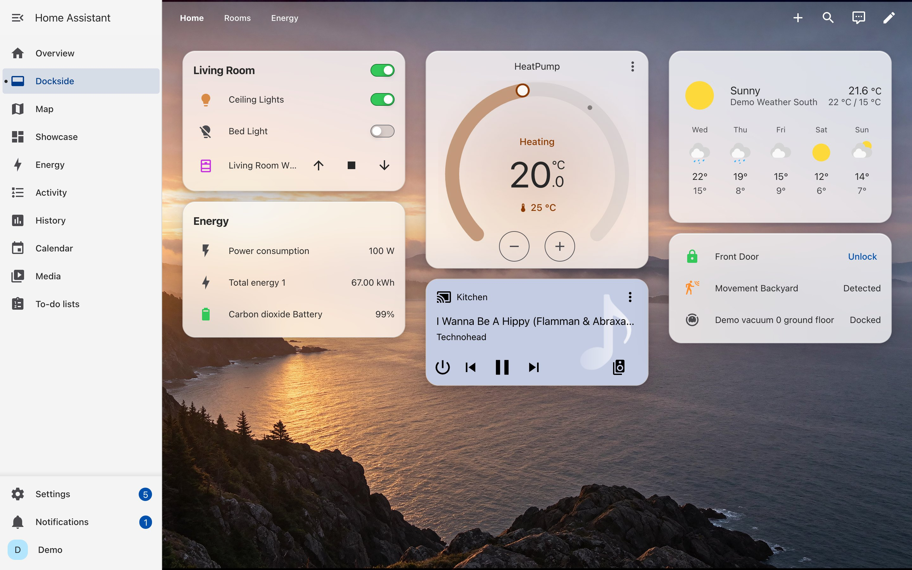
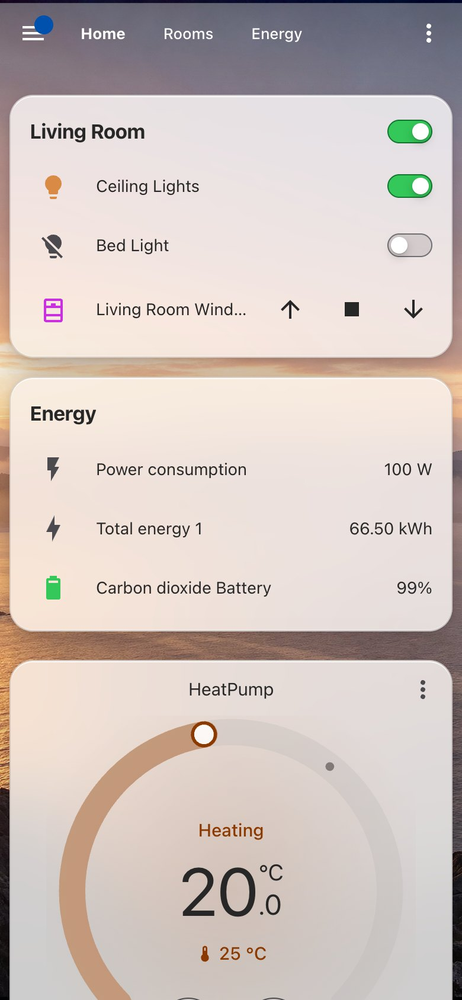
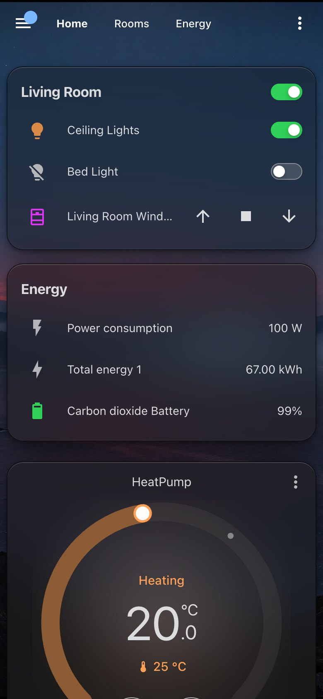
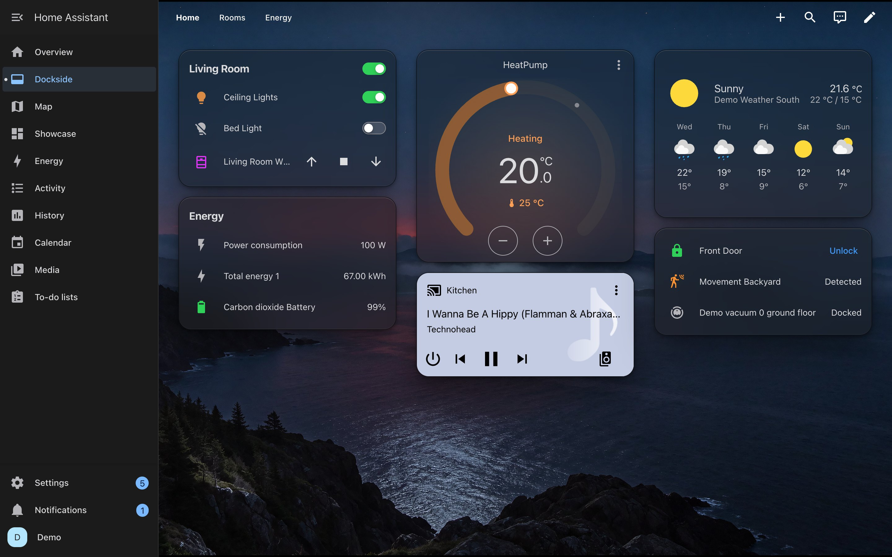
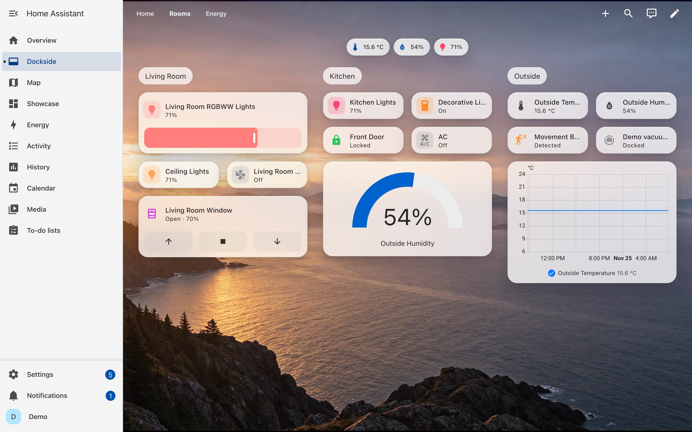
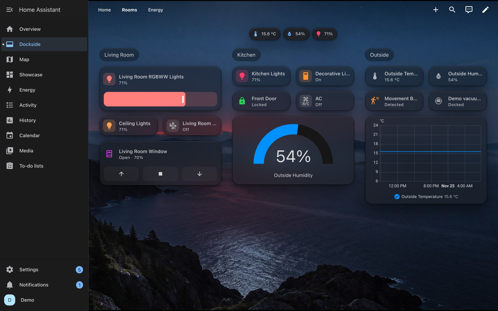
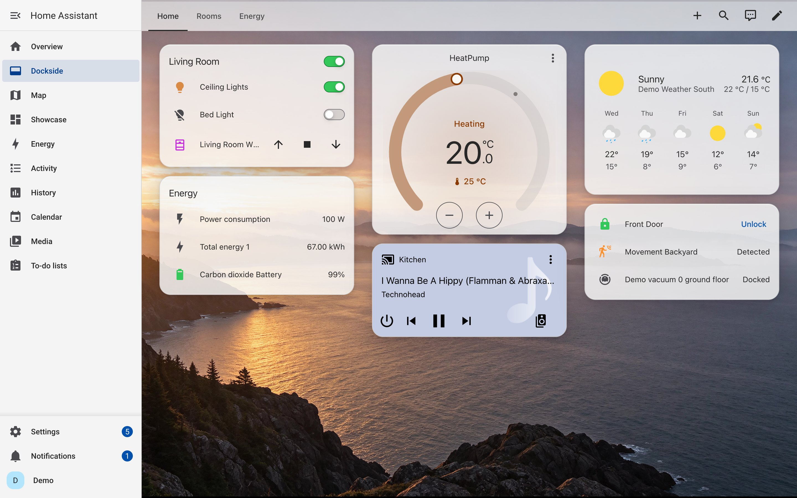
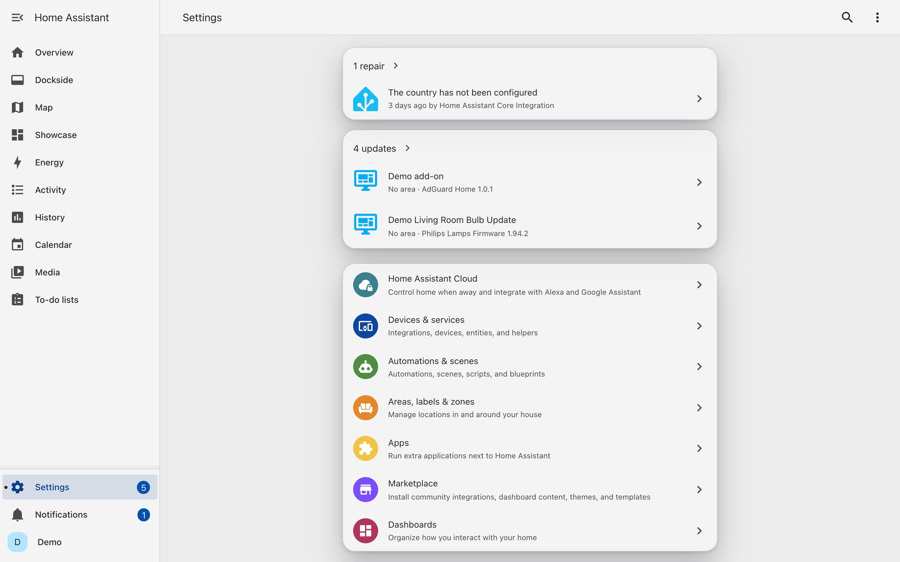
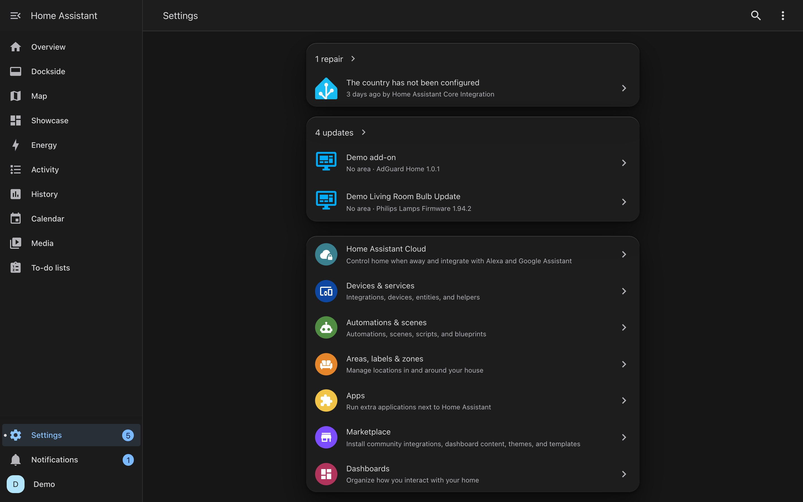

# Dockside

[](https://my.home-assistant.io/redirect/marketplace_repository/?owner=wsclx&repository=dockside-theme&category=theme)

A theme for Home Assistant inspired by the macOS desktop: your dashboard becomes the desktop. A photo of a bay is the wallpaper, cards float above it as frosted glass widgets, and the header is a see-through menu bar with the text right on the picture. Light mode shows the bay at sunset, dark mode the same bay at night.



| Light | Dark |
|---|---|
|  |  |



## What you get

- **A desktop with a wallpaper.** Two photos made for this theme, 5120 × 2880 pixels: a bay at sunset (light) and the same bay at night (dark). They show behind every dashboard. Settings, history, map and the other pages are calm windows without the picture, so charts and tables stay readable.
- **Glass widgets.** Cards are frosted glass with a 20 px radius, a light rim along the top edge, a darker outer edge and a deep shadow, like widgets on the desktop.
- **A menu bar.** With card-mod the dashboard header is fully transparent: white text on a soft shade at the top of the picture, 13 px, the current view in bold and the other views as plain menu titles. Without card-mod the menu bar has a translucent background, like the desktop's option to show one.
- **Readable on the picture.** Every text colour is measured (WCAG 2.2, 4.5:1 for text, 3:1 for controls) against the darkest spot of the light picture and the brightest spot of the dark picture behind the glass. Where a system colour falls short as text, the theme uses a darker or lighter tone of the same hue.
- **Desktop details.** Green switches with a white thumb, blue accents, the system blue focus ring, glass dialogs, widgets with bold titles (card-mod), section headings on small glass capsules (card-mod) and a dot beside the active page in the sidebar, as under a running app in the dock (card-mod).
- **System font.** The system UI font of your device (`-apple-system`, `system-ui`, Segoe UI, Roboto). Nothing is downloaded.
- **One theme, two modes.** It follows the light or dark setting of your profile or device.

| Rooms with tiles, light | Rooms with tiles, dark |
|---|---|
|  |  |

Without card-mod the theme still works: wallpaper, glass widgets, colours, switches and dialogs stay the same. The menu bar keeps a translucent background, widgets are a little more opaque because nothing blurs the picture behind them, and section headings sit directly on the picture.



| Settings, light | Settings, dark |
|---|---|
|  |  |

## Requirements

- Home Assistant with themes enabled. Tested with Home Assistant 2026.11.2 (November 2026).
- Optional: [card-mod](https://github.com/thomasloven/lovelace-card-mod) 4.x for the blur, the transparent menu bar and the other extras. Tested with card-mod 4.2.1.

## Installation

### 1. The theme

**Marketplace:** open **Settings → Marketplace**, search for **Dockside** and download it. Then reload themes: **Developer tools → Actions → `frontend.reload_themes`**.

**Manual:** copy `themes/dockside.yaml` into the `themes` folder of your configuration, make sure `configuration.yaml` loads that folder, then restart Home Assistant or run `frontend.reload_themes`:

```yaml
frontend:
  themes: !include_dir_merge_named themes
```

### 2. The wallpapers

A theme from the Marketplace only installs its YAML file, so the two pictures need one extra step. They go into `/config/www/dockside/`, which Home Assistant serves as `/local/dockside/`. Without them the theme shows a gradient in the colours of the picture instead.

Download both files from the [latest release](https://github.com/wsclx/dockside-theme/releases/latest) (`dockside-light.jpg` and `dockside-dark.jpg`, about 2 MB each) and put them into `/config/www/dockside/`, for example with the File editor or Samba app.

Or, with the Terminal & SSH app:

```sh
mkdir -p /config/www/dockside
cd /config/www/dockside
wget -O dockside-light.jpg https://github.com/wsclx/dockside-theme/releases/latest/download/dockside-light.jpg
wget -O dockside-dark.jpg https://github.com/wsclx/dockside-theme/releases/latest/download/dockside-dark.jpg
```

If the folder `www` did not exist before, restart Home Assistant once so it serves `/local/`. To check, open `http://<your-home-assistant>/local/dockside/dockside-light.jpg` in the browser.

### 3. Use the theme

Open your **profile**, choose **Dockside** under *Theme*, and pick *Auto*, *Light* or *Dark*.

## Your own wallpaper

Dockside reads the picture from one variable per mode, `dockside-wallpaper`. Two ways to use a picture of your own:

- **Replace the files** (recommended, survives theme updates): save your pictures as `dockside-light.jpg` and `dockside-dark.jpg` in `/config/www/dockside/`. A picture from your Mac's desktop works too: copy it from your Mac to that folder under these names. Your browser may keep the old picture for a while; reload the page with the cache cleared.
- **Point the variable elsewhere:** in a copy of the theme, change `dockside-wallpaper` in `light` and `dark`, for example to `url('/local/dockside/my-picture.jpg')`. A theme update replaces the file, so keep your copy under another theme name.

A dashboard view can also have its own background (**Edit dashboard → view settings → Background**); it replaces the theme's picture on that view.

The text colours are measured against the supplied pictures. With a very bright or very busy picture of your own, check that the text on the widgets is still easy to read. If it is not, raise the opacity in `dockside-glass` and `dockside-glass-blurred` in your copy.

## Optional: card-mod

The theme contains `card-mod-card`, `card-mod-root` and `card-mod-sidebar` rules. They only apply when card-mod is installed. For theme rules, card-mod recommends loading it as a frontend module instead of a dashboard resource:

```yaml
frontend:
  themes: !include_dir_merge_named themes
  extra_module_url:
    - /local/community/lovelace-card-mod/card-mod.js
```

Adjust the path to where card-mod is installed on your system.

## Customise

Change the variables below in a copy of the theme (under another name), or override them with card-mod.

| Variable | Used for |
|---|---|
| `dockside-wallpaper` | The picture behind dashboards (per mode) |
| `dockside-fallback` | Gradient shown when the picture is missing (per mode) |
| `dockside-menubar-shade` | Soft shade at the top of the picture behind the menu bar |
| `dockside-menubar` | Background of the menu bar without card-mod, and on pages without the picture |
| `dockside-glass`, `dockside-glass-blurred` | Widget glass without and with blur (card-mod) |
| `dockside-glass-side-blurred`, `dockside-glass-filter` | Sidebar glass and the blur itself (card-mod) |
| `dockside-rim`, `dockside-edge`, `dockside-depth` | Light rim, dark outer edge and shadow of the widgets |
| `dockside-switch-on`, `dockside-switch-on-rim`, `dockside-switch-off` | Switch colours |
| `primary-color`, `sidebar-selected-icon-color` | Blue for links, buttons and the selected sidebar entry |

## Known limits

- **No dock at the bottom.** The navigation stays a glass sidebar on the left. Home Assistant reserves the sidebar column of the window in a place neither a theme nor card-mod reaches, and on phones the sidebar only exists as a drawer behind the menu button. A dock at the bottom would leave an empty column on the left on desktops and would not exist on phones, so Dockside does not fake one. The dot beside the active page is the dock's running-app dot.
- The wallpaper is a dashboard thing. Settings, history, map, logbook and energy pages show a calm window background, because their charts and tables sit directly on the background and would be hard to read on a photo.
- The sidebar sits on the window background, not on the picture.
- The menu bar of a desktop has the time, status icons and menus; a theme cannot add them. The dashboard's own buttons stay on the right.
- Window buttons, desktop icons and app icons are not drawn. Icons stay Material Design Icons; a theme cannot swap icon sets.
- Without card-mod: no blur, the menu bar keeps a background, and section headings sit directly on the picture, where they are not always easy to read. Leave them out or install card-mod.
- Some system colours are darker (light mode) or lighter (dark mode) than on the desktop, so that text on the glass stays readable. Icon colours use the system values, because the state is always also written out.
- The pictures are about 2 MB each. Phones load them once and keep them in the cache.
- The thermostat ring, weather icons and the size of switches are drawn by the frontend; the theme sets their colours.
- Light and media colours that a card takes from the device (a light's RGB colour, album art) stay as they are.
- The system font depends on your device: the system font on Apple devices, Segoe UI on Windows, Roboto on Android, otherwise the default sans-serif.
- Home Assistant does not guarantee theme variables between releases, and the card-mod rules target internal elements of the frontend. A frontend update can break them; the theme itself keeps working. Please open an issue with your version if something looks off.

## Contributing

Issues and pull requests are welcome. Please include your Home Assistant version, card-mod version (if used), browser, whether you use the supplied pictures, and a screenshot.

## License

[MIT](LICENSE), including the two wallpapers in `wallpapers/` and in the releases. The wallpapers were made for this project with an image generator and an upscaler; they show no real place.

This is a community project. It is not affiliated with or endorsed by Home Assistant or the Open Home Foundation. It is inspired by the macOS desktop and not affiliated with Apple Inc.; macOS is a trademark of Apple Inc. No Apple artwork, icons, wallpapers or fonts are included.
